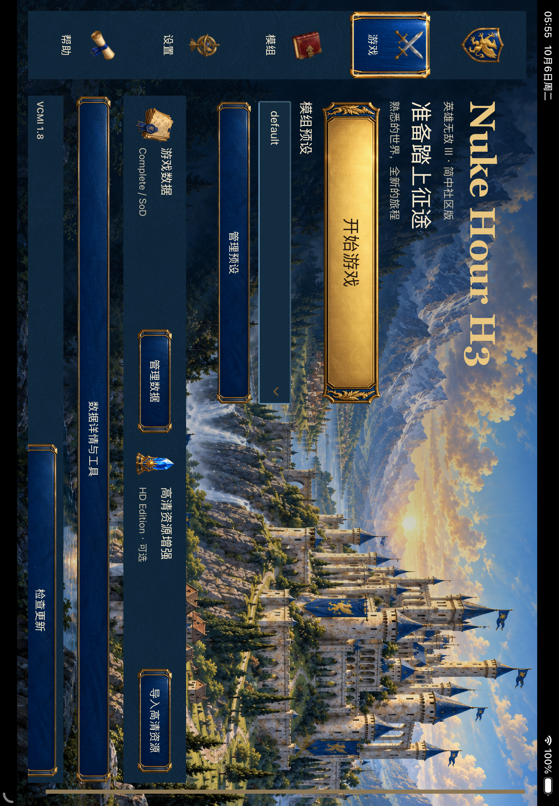

# Nuke Hour H3

An experimental iOS community edition of [VCMI](https://github.com/vcmi/vcmi), with a touch-oriented Simplified Chinese launcher and an original painted fantasy interface.

[简体中文说明](README.zh-CN.md) · [Build for iOS](docs/community/BUILD_IOS.md) · [Validation status](docs/community/STATUS.md) · [Artwork and licenses](docs/community/ARTWORK.md)



## Community changes

- Tablet navigation rail and compact phone navigation; larger controls and scrollable forms.
- Redesigned game, mod, settings, help and import pages, using existing VCMI callbacks.
- Original castle/navy/bronze artwork and separate normal, pressed, active and disabled button plates.
- A square griffin app icon, the `Nuke Hour H3` display name, and an image-free iOS launch screen.
- An optional Noto Sans CJK SC font fallback mod, with its OFL license and pinned provenance.

Baseline: VCMI commit `290525c5518e6fba43143d374d5262acb5c0f5ec`. Upstream engine, author attribution, submodules and license notices are retained. Community code and artwork were developed with AI assistance. This is an independent community fork; the project does not claim VCMI, Ubisoft or Apple endorsement.

## Game data

You must supply your own legally owned **Heroes III Complete or Shadow of Death** data. The repository contains engine/source files, original community artwork and the separately licensed font. Game installation archives, music, maps, HD Edition PAK files and user saves are not supplied.

Official **Heroes III HD Edition** data is an optional enhancement source, not a replacement for Complete/SoD. The fork retains upstream's native HD import path; actual HD loading, Chinese game-content coverage and physical-device A/B acceptance are pending. See [status](docs/community/STATUS.md).

## Get the source

```sh
git clone --recurse-submodules https://github.com/kveinjay-google/Nuke-Hour-H3.git
cd Nuke-Hour-H3
python3 tools/check_community_package.py
```

For the optional font check, install `fonttools` in your own Python environment and run `python3 tools/check_cjk_fonts.py`. Build instructions use your own signing team and bundle prefix. Native build artifacts and provisioning material are excluded from source.

This initial publication is **source only**. It is not an App Store release or a finished Chinese/HD gameplay certification. Device and Simulator builds, a signed M4 iPad installation and bounded launcher smoke/navigation checks succeeded during local development. Map, battle, save/load, full Chinese content and HD physical comparisons remain to be validated.

## License and contributions

VCMI is licensed under **GNU GPL version 2 or later**; see [license.txt](license.txt), existing file notices and [AUTHORS.h](AUTHORS.h). Third-party components retain their own licenses. The CJK font is **OFL-1.1**, with [license](Mods/vcmi-zh-cn-fonts/LICENSE.OFL.txt) and [notice](Mods/vcmi-zh-cn-fonts/NOTICE.md). Original community artwork is provided under GPL-2.0-or-later; its file hashes and generation provenance are [documented](docs/community/ARTWORK.md).

Read [CONTRIBUTING.md](CONTRIBUTING.md) and repository `AGENTS.md` before contributing. Understand and verify submitted changes, preserve upstream attribution, and keep commercial game data and personal signing/test material out of commits. Upstream contribution and AI-use rules continue to apply to upstream issues, pull requests and discussions.
